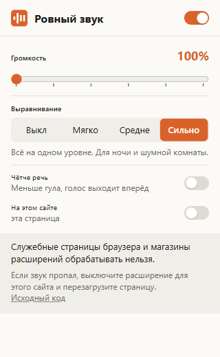

# Steady Volume

[Русский](README.md)

A browser extension for Chromium browsers (Chrome, Edge, Yandex Browser, Opera, Brave) and Firefox. It boosts the sound of video and audio on websites up to 600% and evens out loudness: quiet dialog goes up, loud scenes go down, and a limiter on the output keeps the boosted sound from distorting. All processing happens inside the browser and no data leaves it.



I made it for watching films and series in the browser. Their dialog is mixed quietly and the music and explosions loudly, and at home I kept reaching for the volume.

## Installing

Until the extension is published in the stores, install it from the archive on the [Releases](https://github.com/Erop404iv/steady-volume/releases) page.

### Chrome, Edge, Yandex Browser, Opera, Brave

1. Download `steady-volume-<version>.zip` and unpack it into a folder you will keep.
2. Open the extensions page: `chrome://extensions` in Chrome and Brave, `edge://extensions` in Edge, `browser://extensions` in Yandex Browser, `opera://extensions` in Opera.
3. Turn on Developer mode.
4. Click "Load unpacked" and select the folder that contains `manifest.json`.

The browser shows a developer mode reminder on startup. Once the extension is in the Chrome Web Store, installing takes one click.

### Firefox

Firefox 140 or newer is required. Firefox installs only signed extensions from a file. A signed `.xpi` will appear in Releases after the addons.mozilla.org review. Until then you can load it temporarily, until the browser restarts: `about:debugging` → "This Firefox" → "Load Temporary Add-on" → `manifest.json` from the unpacked archive.

## Settings

| Setting | What it does |
|---|---|
| Volume | Gain from 100% to 600% (up to +15.6 dB). Applied after leveling, peaks are caught by the limiter |
| Leveling | Off, Light, Medium, Strong. A stronger mode leaves less difference between quiet and loud scenes (numbers in the table below) |
| Clearer speech | −4 dB below 160 Hz and +4 dB around 2.8 kHz |
| On this site | Turns processing off for the current site. A video that is already playing switches over without a page reload |

| Mode | Quiet parts raised by up to | Loud parts lowered by up to | Compressor |
|---|---|---|---|
| Light | +6 dB | −6 dB | threshold −16 dB, 2:1 |
| Medium | +12 dB | −12 dB | threshold −22 dB, 3:1 |
| Strong | +20 dB | −20 dB | threshold −28 dB, 6:1 |

## How the processing works

The extension waits for a `<video>` or `<audio>` element to start playing and connects it to a Web Audio chain. Each frame of the page gets its own chain:

1. Filters of the Clearer speech mode.
2. Automatic gain control. Every 100 ms the extension measures the loudness of the last 400 ms with ITU-R BS.1770 K-weighting and moves it towards −20 LUFS. Gain goes down with a time constant of 0.2-0.5 s and comes back up over 1.5-3 s. Below −50 LUFS the gain stays where it is, so silence and background noise are not raised.
3. A `DynamicsCompressorNode` for short peaks that the gain control is too slow to catch.
4. The gain from the Volume slider.
5. A limiter at −2 dB and a soft clipper above 0.8 of full scale.

I built the chain from built-in Web Audio nodes only and left out `AudioWorklet`. An `AudioWorklet` module loads as a separate script, and on sites with a strict CSP, YouTube for one, the browser may block it.

## Where it does not work

- DRM-protected video, for example on Netflix. The browser hands the sound of such video to the extension as silence, so the extension leaves these videos unconnected and they play unprocessed.
- Video loaded from another server without CORS permission. Connecting it would silence it, so the extension skips it and the popup shows a note.
- Calls and voice chats (Google Meet, Discord): elements playing a WebRTC stream are left alone.
- Sites that connect the video to their own Web Audio processing.
- Sound a site plays without `<video>` or `<audio>`, for example in browser games.
- Browser settings pages and extension stores.

If a site loses its sound, turn the extension off for that site and reload the page.

## Privacy

The extension collects no data and makes no network requests. Settings are kept in the browser's `storage.sync`. Details are in [PRIVACY.md](PRIVACY.md).

| Permission | Why |
|---|---|
| `storage` | Keeps the volume, leveling mode and the list of sites where it is off |
| `activeTab` | Lets the popup read the address of the open tab for the On this site switch |
| Script on all sites (`<all_urls>`) | Video appears on any site and inside embedded players; the script connects `<video>` and `<audio>` elements to the processing |

## Testing

The test bench `test/harness.html` renders a synthetic "film" through the chain in an `OfflineAudioContext`: 12 s of quiet dialog, 12 s of loud action with explosions, 12 s of dialog. Loudness in the table is the median RMS level over 400 ms windows, in dB relative to full scale. At the input the dialog sits at −40.9 dB and the action at −24.8 dB, a 16.1 dB difference.

| Mode | Dialog | Action | Difference | Peak |
|---|---|---|---|---|
| No processing | −40.9 | −24.8 | 16.1 dB | +0.7 dB |
| Leveling off, 100% | −40.0 | −23.6 | 16.3 dB | −0.55 dB |
| Light | −32.9 | −22.4 | 10.5 dB | −0.43 dB |
| Medium | −24.0 | −20.2 | 3.8 dB | −0.46 dB |
| Strong | −21.6 | −18.7 | 2.9 dB | −1.53 dB |

The end-to-end tests install the extension in a browser and play the same file. I ran them on Windows 10 in Edge 155 (`test/e2e.mjs`) and Firefox 157 (`test/e2e-firefox.mjs`). They check that quiet dialog is raised, loud action is lowered, and video from another server without CORS keeps playing unprocessed with its sound. They also check that the site switch takes effect without a reload. On YouTube in Edge 155 the extension connected to the video and lowered a loud clip by 4 dB.

```bash
npm install
node test/make-movie.mjs     # writes test/movie.wav
node test/e2e.mjs msedge     # or chrome, chromium
node test/e2e-firefox.mjs
npm run serve                # bench: http://127.0.0.1:8765/test/harness.html
```

## Building

```bash
npm run lint    # checks the manifest and code with web-ext
npm run build   # archive in dist/, the same one for every browser
```

One `manifest.json` serves Chromium and Firefox, since Chromium skips the `browser_specific_settings` block. Pushing a `v*` tag makes GitHub Actions build the archive and attach it to a release. If the repository secrets hold AMO keys, the same run signs an `.xpi` for Firefox.

The extension code was written by Claude from Anthropic to my specification.

## License

MIT, see [LICENSE](LICENSE).

## If something does not work

Open an [issue](https://github.com/Erop404iv/steady-volume/issues) with the page address, your browser and its version, and the text from the bottom of the popup while the video plays.
