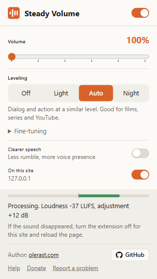

# Steady Volume

[](https://github.com/olerast67/steady-volume/releases/latest)
[](LICENSE)


[Русский](README.md)

A browser extension that boosts video volume up to 600% and levels loudness. Quiet film dialog goes up, explosions and music go down, and a limiter on the output keeps the boosted sound from distorting. It works in Chrome, Edge, Yandex Browser, Opera, Brave and Firefox, processes sound inside the browser and sends nothing anywhere.



I made it for watching films and series in the browser. Their dialog is mixed quietly and the action loudly, and at home I kept reaching for the volume.

## How to use

1. Install the extension as described below.
2. Play a video. The extension connects on its own in Auto mode, nothing needs setting up.
3. If the sound is still quiet, move the Volume slider. At night switch to Night mode.

When the extension cannot connect to a video directly, for example on a DRM-protected site, Chrome, Edge, Yandex Browser, Opera and Brave let it process the sound of the whole tab. Capture starts by itself when you open the popup, with the "Process the whole tab's sound" button, or with Alt+Shift+V.

The popup opens from the extension icon on the browser toolbar. If the icon is hidden, click the puzzle icon to the right of the address bar and pin Steady Volume.

## Installing

While the extension is in store review, install it from the archive. It takes about a minute.

### Chrome, Edge, Yandex Browser, Opera, Brave

1. Download `steady-volume-<version>-chromium.zip` from the [latest release](https://github.com/olerast67/steady-volume/releases/latest) and unpack it into a folder you will keep. Deleting the folder removes the extension from the browser.
2. Open the extensions page by typing its address into the address bar:

   | Browser | Address |
   |---|---|
   | Chrome, Brave | `chrome://extensions` |
   | Edge | `edge://extensions` |
   | Yandex Browser | `browser://extensions` |
   | Opera | `opera://extensions` |

3. Turn on Developer mode. In Chrome the switch is at the top right, in Edge at the bottom left.
4. Click "Load unpacked" and select the unpacked folder that contains `manifest.json`.

On every start Chrome offers to disable developer mode extensions. Click Cancel or close the dialog. When the extension is in the Chrome Web Store, the link will be here and installing will take one click.

### Firefox

Firefox 140 or newer is required. Firefox installs from a file only extensions signed by Mozilla. A signed `.xpi` will appear in the releases after the addons.mozilla.org review. Until then you can load it until the browser restarts: download `steady-volume-<version>-firefox.zip`, unpack it, open `about:debugging` → "This Firefox" → "Load Temporary Add-on" and select `manifest.json`.

## Modes and settings

| Setting | What it does |
|---|---|
| Volume | Gain from 100% to 600% (up to +15.6 dB) on top of leveling. Peaks are caught by the limiter |
| Leveling | Off, Light, Auto, Night. Auto is on by default |
| Clearer speech | −4 dB below 160 Hz and +4 dB around 2.8 kHz |
| On this site | Turns processing off for the current site. A video that is already playing switches over without a reload |

| Mode | For | Quiet parts raised by up to | Loud parts lowered by up to | Compressor |
|---|---|---|---|---|
| Off | Volume boost only, dynamics stay as recorded | 0 | 0 | off |
| Light | Music and clips | +6 dB | −6 dB | threshold −16 dB, 2:1 |
| Auto | Films, series, YouTube | +12 dB | −12 dB | threshold −22 dB, 3:1 |
| Night | Watching quietly at night, noisy rooms | +20 dB | −20 dB | threshold −28 dB, 6:1 |

The Fine-tuning section has seven sliders: target loudness (−30 to −12 LUFS), how far quiet parts are raised and loud parts lowered (up to 24 dB), gain recovery time (0.5-6 s), compressor threshold and ratio, and the limiter ceiling (−12 to 0 dB). Any change switches the mode to custom. Reset all brings back Auto, 100% and turns Clearer speech off.

The popup is translated into 18 languages: English, Russian, Ukrainian, German, French, Spanish, Italian, Portuguese (Brazil), Polish, Turkish, Japanese, Korean, Chinese (Simplified and Traditional), Indonesian, Vietnamese, Hindi and Arabic. The language follows the browser settings. All translations except Russian and English were made with an AI model; corrections are welcome in `scripts/locales.py`.

## How the processing works

The extension waits for a `<video>` or `<audio>` element to start playing and connects it to a Web Audio chain. Each frame of the page gets its own chain:

1. Filters of the Clearer speech mode.
2. Automatic gain control. Every 100 ms the extension measures the loudness of the last 400 ms with ITU-R BS.1770 K-weighting and moves it towards −20 LUFS. Gain goes down with a time constant of 0.2-0.5 s and comes back up over 1.5-3 s. Below −50 LUFS the gain stays where it is, so silence and background noise are not raised.
3. A `DynamicsCompressorNode` for short peaks that the gain control is too slow to catch.
4. The gain from the Volume slider.
5. A limiter with a −2 dB ceiling and a soft clipper above 0.8 of full scale.

I built the chain from built-in Web Audio nodes only and left out `AudioWorklet`. An `AudioWorklet` module loads as a separate script, and on sites with a strict CSP, YouTube for one, the browser may block it.

Many players load the video file from a content delivery server on another domain. The browser lets an extension process the sound of such a file only if the server response allows it with CORS headers. The extension adds these headers with a `declarativeNetRequest` rule. The rule covers one pair of this site and this server, and only requests made by `<video>` and `<audio>` elements. Then the extension reloads the video with the `crossorigin` attribute at the same second and connects it. Embedded VK Video players on other sites work this way.

Web-component players keep `<video>` inside a Shadow DOM, where page events do not reach. The extension finds such players, closed Shadow DOM included, every 2 seconds and when a video starts.

The browser hands the sound of DRM-protected video to extensions as silence. For that case Chromium browsers have whole-tab capture through `tabCapture`. While capture is on, the tab is heard only through the extension: the sound goes to a separate extension document, passes the same chain and goes out to the speakers. Firefox has no tab capture.

## Where it works and where it does not

| What plays | Chromium (Chrome, Edge, Yandex, Opera, Brave) | Firefox |
|---|---|---|
| YouTube, HLS and DASH players | yes | yes |
| Files from a CDN on another domain, embedded VK Video players | yes | yes |
| Players in Shadow DOM | yes | yes |
| DRM-protected video (Netflix, paid streaming) | through tab capture | no |
| Sound without `<video>` or `<audio>` (browser games, sites with their own Web Audio processing) | through tab capture | no |
| Calls and voice chats (Google Meet, Discord) | skipped | skipped |
| Browser pages and extension stores | no | no |

I tested tab capture on a dash.js sample video encrypted with ClearKey. It uses the same EME mechanism as Netflix and paid streaming protection, with an open key. I have not tested it on Netflix itself. For embedded VK Video players I checked how their requests work: the live VK player shows a bot check to an automated browser.

If a site loses its sound, turn the extension off for that site with the On this site switch, reload the page and open an issue with the page address.

## Questions

Does it work on Netflix? In Chromium browsers it should, through tab capture: open the popup while watching and capture starts by itself. I have not tested it on Netflix. In Firefox it does not. There, use system-wide processing: on Windows that is Loudness Equalization in the speaker properties or Equalizer APO with a compressor.

Does it work on phones? The manifest supports Firefox for Android 142 and newer. I have not tested it on a phone.

Is the sound delayed relative to the picture? Web Audio processing adds output latency, and tab capture adds more. I have not measured it; on the test videos I could not hear any offset.

Why access to all sites? Video can appear on any site and inside embedded players from other domains. On a page the extension reads only `<video>` and `<audio>` elements, and the CORS header rules are needed for the servers the players load video from.

## Privacy

The extension collects no data and makes no network requests of its own. Settings are kept in the browser's `storage.sync`; the CORS header rules last until the browser closes. Captured tab sound is processed and played straight to the speakers; the extension does not record it. Details are in [PRIVACY.md](PRIVACY.md).

| Permission | Why |
|---|---|
| `storage` | Keeps the volume, the mode and the list of sites where it is off |
| `activeTab` | Lets the popup read the address of the open tab for the On this site switch |
| Access to all sites (`<all_urls>`) | The script connects `<video>` and `<audio>` elements to the processing on any site and inside embedded players |
| `declarativeNetRequestWithHostAccess` | Adds CORS headers to the video server's responses so the browser allows processing their sound |
| `tabCapture`, `offscreen` (Chromium only) | Captures the tab's sound for DRM-protected video and sites whose players cannot be connected directly |

## Support the project

The extension is free, with no ads and no paid features. If it helps you:

- Star the repository, stars help others find it.
- Donate on [Boosty](https://boosty.to/olerast/donate), it takes cards from most countries. Other ways, including USDT, are in [DONATE.md](DONATE.md).
- Open an issue naming a site where the extension did not connect.

## Testing

The test bench `test/harness.html` renders a synthetic "film" through the chain in an `OfflineAudioContext`: 12 s of quiet dialog, 12 s of loud action with explosions, 12 s of dialog. Loudness in the table is the median RMS level over 400 ms windows, in dB relative to full scale, at 100% volume.

| Mode | Dialog | Action | Difference | Peak |
|---|---|---|---|---|
| No extension | −40.9 | −24.8 | 16.1 dB | +0.7 dB |
| Off | −41.1 | −24.8 | 16.2 dB | −1.4 dB |
| Light | −33.9 | −23.5 | 10.4 dB | −1.2 dB |
| Auto | −25.2 | −21.4 | 3.8 dB | −1.2 dB |
| Night | −22.8 | −19.8 | 3.0 dB | −2.7 dB |

The end-to-end tests install the extension in a browser and play the same file. I ran them on Windows 10 in Edge 155 (`test/e2e.mjs`, `test/e2e-capture.mjs`) and Firefox 157 (`test/e2e-firefox.mjs`). They check that quiet dialog is raised and loud action lowered. Video from another server, with CORS and without, must connect, continue from the same second, and its level at the processing input must be above −50 LUFS. A player in a closed Shadow DOM must connect too. The tests also switch the site and the fine-tuning from the popup and turn tab capture on and off. I also tested tab capture on a ClearKey-encrypted video from the dash.js samples. On YouTube in Edge 155 the extension connected to the video and lowered a loud clip by 4 dB.

```bash
npm install
node test/make-movie.mjs     # writes test/movie.wav
node test/e2e.mjs msedge     # or chrome, chromium
node test/e2e-capture.mjs msedge
npm run lint && node test/e2e-firefox.mjs
npm run serve                # bench: http://127.0.0.1:8765/test/harness.html
```

## Building

```bash
npm run lint    # builds build/chromium and build/firefox, lints the Firefox one with web-ext
npm run build   # dist/steady-volume-<version>-chromium.zip and -firefox.zip
```

`src/manifest.json` is written for Chromium. `scripts/build.mjs` derives the Firefox version from it: a background script without a service worker, no `tabCapture`, `offscreen` or keyboard shortcut. Pushing a `v*` tag makes GitHub Actions build the archive and attach it to a release. If the repository secrets hold AMO keys, the same run signs an `.xpi` for Firefox. Store publishing steps are in [docs/publishing.md](docs/publishing.md).

The extension code was written by Claude from Anthropic to my specification.

## License

MIT, see [LICENSE](LICENSE).

## If something does not work

Open an [issue](https://github.com/olerast67/steady-volume/issues/new/choose) with the page address, your browser and its version, and the text from the bottom of the popup while the video plays.
