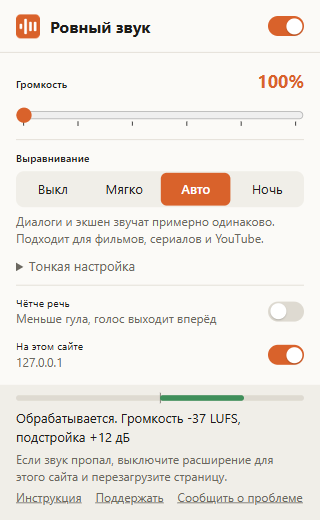

# Ровный звук

[](https://github.com/olerast67/steady-volume/releases/latest)
[](LICENSE)


[English](README.en.md)

Расширение для браузера, которое усиливает звук видео до 600% и выравнивает громкость. Тихие диалоги в фильмах поднимаются, взрывы и музыка опускаются, лимитер на выходе не даёт усиленному звуку хрипеть. Работает в Chrome, Edge, Яндекс Браузере, Opera, Brave и Firefox, обрабатывает звук внутри браузера и ничего никуда не отправляет.



Я сделал его для фильмов и сериалов в браузере. Разговоры в них записаны тихо, а экшен громко, и при просмотре дома я всё время крутил громкость.

## Как пользоваться

1. Поставьте расширение по инструкции ниже.
2. Включите видео. Расширение подключится само в режиме «Авто», настраивать ничего не нужно.
3. Если звук всё равно тихий, сдвиньте ползунок «Громкость». Ночью включите режим «Ночь».

Окно расширения открывается по значку на панели браузера. Если значка не видно, нажмите на значок пазла справа от адресной строки и закрепите «Ровный звук».

## Установка

Пока расширение проходит проверку в магазинах, его можно поставить из архива. Это занимает около минуты.

### Chrome, Edge, Яндекс Браузер, Opera, Brave

1. Скачайте `steady-volume-<версия>.zip` со страницы [последнего релиза](https://github.com/olerast67/steady-volume/releases/latest) и распакуйте в папку, которую не будете удалять. Если папку удалить, расширение пропадёт из браузера.
2. Откройте страницу расширений. Адрес нужно вставить в адресную строку:

   | Браузер | Адрес |
   |---|---|
   | Chrome, Brave | `chrome://extensions` |
   | Edge | `edge://extensions` |
   | Яндекс Браузер | `browser://extensions` |
   | Opera | `opera://extensions` |

3. Включите «Режим разработчика». В Chrome переключатель находится справа вверху, в Edge слева внизу.
4. Нажмите «Загрузить распакованное расширение» и выберите распакованную папку, в которой лежит `manifest.json`.

При каждом запуске Chrome предлагает отключить расширения в режиме разработчика. Нажмите «Отмена» или закройте окно. Когда расширение появится в Chrome Web Store, ссылка будет здесь, и установка займёт одно нажатие.

### Firefox

Нужен Firefox 140 или новее. Firefox ставит из файла только расширения, подписанные Mozilla. Подписанный файл `.xpi` появится в релизах после проверки на addons.mozilla.org. До этого расширение можно загрузить на время, до перезапуска браузера: `about:debugging` → «Этот Firefox» → «Загрузить временное дополнение» → файл `manifest.json` из распакованного архива.

## Режимы и настройки

| Настройка | Что делает |
|---|---|
| Громкость | Усиление от 100% до 600% (до +15,6 дБ) поверх выравнивания. Пики срезает лимитер |
| Выравнивание | Выкл, Мягко, Авто, Ночь. Режим «Авто» включён по умолчанию |
| Чётче речь | Минус 4 дБ ниже 160 Гц и плюс 4 дБ около 2,8 кГц |
| На этом сайте | Выключает обработку на текущем сайте. Видео, которое уже играет, переключается без перезагрузки |

| Режим | Для чего | Подъём тихого, до | Снижение громкого, до | Компрессор |
|---|---|---|---|---|
| Выкл | Только усиление, динамика остаётся как в записи | 0 | 0 | выключен |
| Мягко | Музыка и клипы | +6 дБ | −6 дБ | порог −16 дБ, 2:1 |
| Авто | Фильмы, сериалы, YouTube | +12 дБ | −12 дБ | порог −22 дБ, 3:1 |
| Ночь | Тихий просмотр ночью, шумная комната | +20 дБ | −20 дБ | порог −28 дБ, 6:1 |

В разделе «Тонкая настройка» семь ползунков: целевая громкость (от −30 до −12 LUFS), подъём тихого и снижение громкого (до 24 дБ), время возврата громкости (0,5-6 с), порог и степень сжатия компрессора, потолок лимитера (от −12 до 0 дБ). После любого изменения режим становится «свои настройки». Кнопка «Сбросить всё» возвращает «Авто», 100% и выключает «Чётче речь».

## Как устроена обработка

Расширение ждёт, когда на странице начнёт играть `<video>` или `<audio>`, и подключает элемент к цепочке Web Audio. В каждом фрейме страницы цепочка своя:

1. Фильтры режима «Чётче речь».
2. Автоматическая регулировка усиления. Каждые 100 мс расширение измеряет громкость за последние 400 мс с K-взвешиванием по ITU-R BS.1770 и плавно ведёт её к −20 LUFS. Громкость опускается с постоянной времени 0,2-0,5 с, поднимается за 1,5-3 с. Если громкость ниже −50 LUFS, усиление остаётся прежним, чтобы тишина и шум не поднимались.
3. Компрессор `DynamicsCompressorNode` для коротких скачков, которые регулировка не успевает поймать.
4. Усиление из ползунка «Громкость».
5. Лимитер с потолком −2 дБ и мягкое ограничение выше 0,8 от полной шкалы.

Я собрал цепочку только из встроенных узлов Web Audio и отказался от `AudioWorklet`. Модуль `AudioWorklet` загружается отдельным скриптом, и на сайтах со строгой политикой CSP, например на YouTube, браузер может его заблокировать.

Многие плееры берут файл видео с сервера раздачи (CDN) на другом домене. Браузер даёт обработать звук такого файла, только если сервер разрешает это заголовками CORS. Расширение отправляет на сервер один запрос и смотрит заголовки. Если CORS разрешён, оно перезагружает видео с атрибутом `crossorigin` с той же секунды и подключает к обработке. Если запрещён, видео играет как есть.

## Где работает и где нет

Расширение работает с плеерами, которые играют видео через `<video>` и `<audio>`. Сюда входят YouTube, плееры на HLS и DASH и файлы с серверов, которые разрешают CORS. Я проверял его на YouTube и на тестовых страницах из папки `test`.

Расширение не обрабатывает:

- Видео с защитой DRM. Так защищают фильмы на Netflix и в платных онлайн-кинотеатрах. Браузер отдаёт звук такого видео расширению тишиной, поэтому расширение его не трогает и оно играет как есть.
- Видео с сервера, который запрещает CORS. В окне расширения появляется пояснение.
- Звонки и голосовые чаты (Google Meet, Discord). Элементы с потоком WebRTC расширение пропускает.
- Сайты, которые сами подключают видео к своей обработке Web Audio.
- Звук, который сайт играет без `<video>` и `<audio>`, например в браузерных играх.
- Служебные страницы браузера и магазины расширений.

Если звук на сайте пропал, выключите расширение для этого сайта переключателем «На этом сайте» и перезагрузите страницу. Потом откройте issue с адресом страницы.

## Вопросы

Почему не работает Netflix или Кинопоиск? Эти сервисы шифруют видео (DRM), и браузер закрывает расширениям доступ к их звуку. Обойти это из расширения нельзя. Для таких сервисов подходит обработка звука на уровне системы: в Windows это «Тонкомпенсация» в свойствах динамиков или Equalizer APO с компрессором.

Работает ли на телефоне? Манифест поддерживает Firefox для Android 142 и новее. На телефоне я расширение не проверял.

Отстаёт ли звук от картинки? Обработка Web Audio добавляет задержку вывода звука. Я её не замерял, на тестовых видео рассинхрон на слух не заметен.

Зачем доступ ко всем сайтам? Видео бывает на любом сайте и во встроенных плеерах с других доменов. Расширение читает на странице только элементы `<video>` и `<audio>`.

## Приватность

Расширение не собирает данные. Сетевой запрос оно делает в одном случае: проверяет заголовки CORS у файла видео, который страница и так загружает. Настройки хранятся в `storage.sync` браузера. Подробнее в [PRIVACY.md](PRIVACY.md).

| Разрешение | Зачем |
|---|---|
| `storage` | Хранит громкость, режим и список выключенных сайтов |
| `activeTab` | Окно расширения узнаёт адрес открытой вкладки для переключателя «На этом сайте» |
| Скрипт на всех сайтах (`<all_urls>`) | Подключает к обработке элементы `<video>` и `<audio>` на любом сайте и во встроенных плеерах |

## Поддержать проект

Расширение бесплатное, без рекламы и платных функций. Если оно вам пригодилось:

- Поставьте звезду репозиторию, по звёздам его находят другие.
- Задонатьте на [Boosty](https://boosty.to/olerast/donate), там принимают карты «Мир» и СБП. Другие способы, включая USDT, в [DONATE.md](DONATE.md).
- Напишите в issue, на каком сайте расширение не подключилось.

## Проверка

Тестовый стенд `test/harness.html` прогоняет синтетический «фильм» через цепочку в `OfflineAudioContext`: 12 с тихого диалога, 12 с громкого экшена со взрывами, 12 с диалога. Громкость в таблице это медиана среднеквадратичного уровня по окнам 400 мс, в дБ от полной шкалы, при громкости 100%.

| Режим | Диалог | Экшен | Разница | Пик |
|---|---|---|---|---|
| Без расширения | −40,9 | −24,8 | 16,1 дБ | +0,7 дБ |
| Выкл | −41,1 | −24,8 | 16,2 дБ | −1,4 дБ |
| Мягко | −33,9 | −23,5 | 10,4 дБ | −1,2 дБ |
| Авто | −25,2 | −21,4 | 3,8 дБ | −1,2 дБ |
| Ночь | −22,8 | −19,8 | 3,0 дБ | −2,7 дБ |

Сквозные тесты ставят расширение в браузер и проигрывают тот же файл. Я запускал их на Windows 10 в Edge 155 (`test/e2e.mjs`) и Firefox 157 (`test/e2e-firefox.mjs`). Тесты проверяют подъём тихого диалога и снижение громкого экшена. Видео с чужого сервера без CORS должно играть без обработки и со звуком, а видео с сервера с CORS должно подключиться и продолжить играть с той же секунды. Ещё тесты переключают сайт и тонкую настройку из окна расширения. На YouTube в Edge 155 расширение подключилось к видео и снизило громкий ролик на 4 дБ.

```bash
npm install
node test/make-movie.mjs     # тестовый файл test/movie.wav
node test/e2e.mjs msedge     # или chrome, chromium
node test/e2e-firefox.mjs
npm run serve                # стенд: http://127.0.0.1:8765/test/harness.html
```

## Сборка

```bash
npm run lint    # проверка манифеста и кода через web-ext
npm run build   # архив в dist/, один и тот же для всех браузеров
```

Один `manifest.json` подходит для Chromium и Firefox, блок `browser_specific_settings` Chromium пропускает. При публикации тега `v*` GitHub Actions собирает архив и прикладывает его к релизу. Если в секретах репозитория есть ключи AMO, тот же процесс подписывает `.xpi` для Firefox. Порядок публикации в магазинах описан в [docs/publishing.md](docs/publishing.md).

Код расширения написал Claude от Anthropic по моей постановке задачи.

## Лицензия

MIT, текст в [LICENSE](LICENSE).

## Если что-то не работает

Откройте [issue](https://github.com/olerast67/steady-volume/issues/new/choose) и укажите адрес страницы, браузер с версией и текст из нижней части окна расширения во время воспроизведения.
